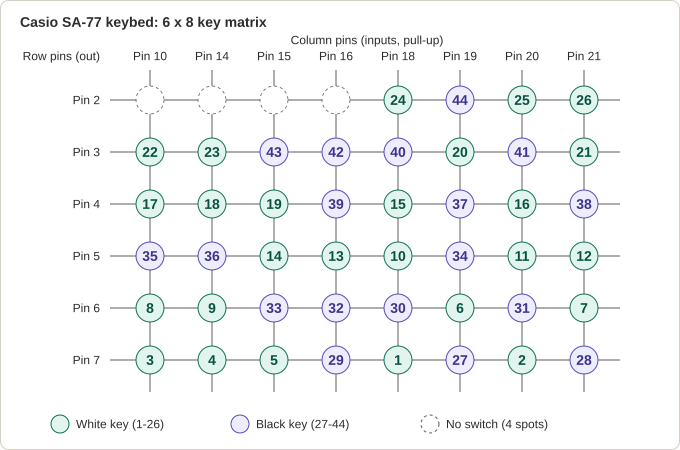
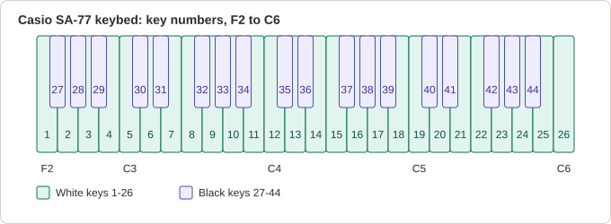
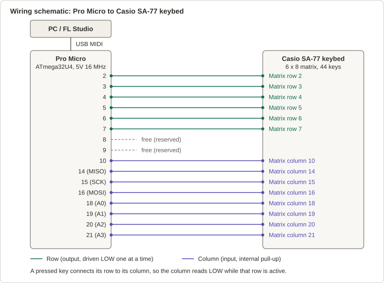

# Casio SA-77 USB MIDI Keyboard

**A Casio SA-77 keybed, an Arduino Pro Micro and 14 jumper wires, turned into a 44-key USB MIDI keyboard that plays Keyscape and Noire in FL Studio.**



<!-- TODO: add a hero photo or short demo video of the finished keyboard here -->

## Why this project

The Casio SA-77 is a small 44-key keyboard, and under the keys it is beautifully simple: every key is a single switch sitting on a grid of wires. That makes the keybed a great candidate for a second life. Connect that grid to a microcontroller that speaks USB MIDI, and the same keys can play any virtual instrument on a computer.

This repository documents the whole build: how the 6 x 8 key matrix was reverse engineered with a small sketch, how the keys map to MIDI notes, how everything is wired, and what to know before building your own.

## Features

- 44 keys, F2 to C6 (MIDI notes 41 to 84)
- USB MIDI over the Arduino MIDIUSB library, no extra hardware needed
- Fully mapped 6 x 8 key matrix (48 intersections, 44 keys, 4 intentionally empty spots)
- A key-finder tool that rebuilds the key map for any similar keybed
- Works with FL Studio, tested with the Keyscape and Noire sampled pianos
- Pins 8 and 9 are free for future add-ons

## How it works

### 1. Matrix scanning

The keybed is a grid of 6 row lines and 8 column lines. That is 48 intersections, 44 of which have a key; the 4 others are intentionally empty on the Casio PCB.

The Pro Micro drives one row pin LOW at a time and reads all 8 column pins, which use the internal pull-up resistors. If a column reads LOW while a row is active, the key at that intersection is pressed.

### 2. Finding which key is which

Instead of tracing the PCB by hand, the key map was recovered with a small checklist sketch (`tools/key_mapper`). All 26 white keys were pressed in order from left to right, then all 18 black keys from left to right. The Serial Monitor logged every new key like this:

```
SUCCESS: NEW KEY [1/44] -> Row: 7 | Col: 18
```

Each log line became one entry in the `keyMap` table, giving every physical key a number from 1 to 44 (white keys 1-26, black keys 27-44). The sketch also flags duplicates, so every key can be verified once.

### 3. Key number to MIDI note

A second lookup table, `midiPitch`, converts the key number to a MIDI note: key 1 is F2 (41) and key 26 is C6 (84) on the white keys, and the black keys run from F#2 (42) to A#5 (82).



### 4. Velocity and note release

Each key has a single contact, so the keybed cannot measure how hard a key is pressed. Velocity is not sensed by the hardware.

In this firmware every note-on is sent at a fixed velocity of 127, and note-off is sent with velocity 0. Change the value in the `noteOn(...)` call if you want the keys to play softer.

The smooth fade at the end of a note comes from the instrument, not the keyboard. A sampled piano such as Keyscape or Noire plays its own release and damper samples when it receives a note-off. For synths, raise the Release time in the envelope.

## Hardware

| Part | Notes |
|---|---|
| Casio SA-77 keybed | 44 keys, 14-pin matrix connector (6 rows x 8 columns) |
| Xcluma ATmega32U4 5V/16MHz Pro Micro (Mini Leonardo) | USB MIDI-capable board |
| 14 female-to-male jumper wires | Keybed connector to the Pro Micro |
| Breadboard | For prototype testing before final assembly |
| Solder, tape, misc. | Final assembly |
| USB cable | Matching your board's connector |

## Wiring



| Pro Micro pin | Board label | Role |
|---|---|---|
| 2, 3, 4, 5, 6, 7 | 2 to 7 | Matrix rows (outputs) |
| 10 | 10 | Matrix column (input, pull-up) |
| 14, 15, 16 | MISO, SCK, MOSI | Matrix columns |
| 18, 19, 20, 21 | A0, A1, A2, A3 | Matrix columns |
| 8, 9 | 8, 9 | Free |

<!-- TODO: add photos: docs/images/ribbon_wiring.jpg, docs/images/pro_micro_wiring.jpg, docs/images/prototype_breadboard.jpg -->

## Key map

Each cell is the key number at that row and column intersection (1-26 white keys, 27-44 black keys, `-` means no switch). The same data is in [`docs/matrix_pinout.csv`](docs/matrix_pinout.csv) together with the MIDI note of each key.

| | Col 10 | Col 14 | Col 15 | Col 16 | Col 18 | Col 19 | Col 20 | Col 21 |
|---|---|---|---|---|---|---|---|---|
| **Row 2** | - | - | - | - | 24 | 44 | 25 | 26 |
| **Row 3** | 22 | 23 | 43 | 42 | 40 | 20 | 41 | 21 |
| **Row 4** | 17 | 18 | 19 | 39 | 15 | 37 | 16 | 38 |
| **Row 5** | 35 | 36 | 14 | 13 | 10 | 34 | 11 | 12 |
| **Row 6** | 8 | 9 | 33 | 32 | 30 | 6 | 31 | 7 |
| **Row 7** | 3 | 4 | 5 | 29 | 1 | 27 | 2 | 28 |

## Build it yourself

1. Prototype on a breadboard first. Connect the keybed to the Pro Micro with jumper wires as shown above.
2. If your keybed is different from the SA-77, run `tools/key_mapper` and press every key once (white keys first, then black keys). Copy the logged row and column of each key into your own `keyMap`.
3. Flash the main sketch from `firmware/casio_sa77_midi`.
4. Test every key in FL Studio, then solder the final connections.

### Arduino IDE settings

- Board: Arduino Leonardo (works for 5V/16MHz Pro Micro boards)
- Library: MIDIUSB, installed from the Library Manager

<!-- TODO: confirm the board setting you used when flashing -->

## Using it with FL Studio

Open Options, then MIDI Settings, select the keyboard under Input and enable it. Load Keyscape, Noire or any other instrument and play.

## Ideas for the free pins

Pins 8 and 9 are unused. Possible additions: a sustain pedal (MIDI CC 64), octave up/down buttons (the keybed spans only F2 to C6), or a knob for volume or modulation.

## Repository layout

```
casio-sa77-usb-midi-keyboard/
├── README.md
├── LICENSE
├── .gitignore
├── firmware/
│   └── casio_sa77_midi/
│       └── casio_sa77_midi.ino
├── tools/
│   └── key_mapper/
│       └── key_mapper.ino
└── docs/
    ├── matrix_pinout.csv
    ├── schematic.svg
    ├── keymap_matrix.svg
    ├── keyboard_layout.svg
    └── images/
```

## License

MIT, see [LICENSE](LICENSE).
